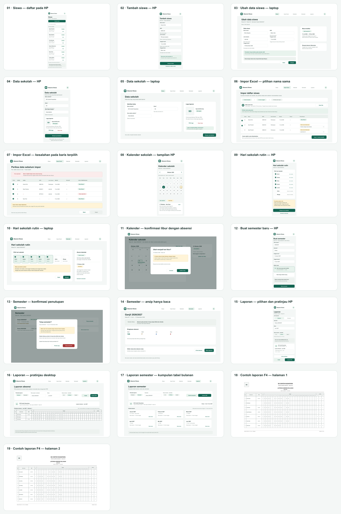

# Desain lanjutan pengelolaan dan laporan — LAB002-UI-002

Status: **desain statis untuk review PM** · 12 Oktober 2026  
Acuan visual: UI001 `APPROVED/CLOSED`, PRD R01–R15, `local-delivery-contract-v1.md` dan keputusan C03–C08.  
Semua sekolah, nama, NIPD, logo, tanggal dan rekap pada mockup adalah contoh fiktif.

## Lihat rancangan

PNG untuk review cepat; SVG di folder yang sama adalah sumber vektor. Ukuran berkas per layar tertera di kolom ukuran, dalam piksel. Ukuran tidak membuktikan layout responsif di browser atau ukuran cetak fisik.

| No. | Tampilan | Ukuran PNG/SVG | Berkas |
|---|---|---:|---|
| 01 | Daftar siswa · HP | 390 × 1160 | [PNG](01-siswa-hp-daftar.png) · [SVG](01-siswa-hp-daftar.svg) |
| 02 | Tambah siswa · HP | 390 × 920 | [PNG](02-siswa-hp-form-tambah.png) · [SVG](02-siswa-hp-form-tambah.svg) |
| 03 | Ubah siswa dan masa terdaftar · laptop | 1440 × 880 | [PNG](03-siswa-laptop-edit.png) · [SVG](03-siswa-laptop-edit.svg) |
| 04 | Metadata sekolah dan logo · HP | 390 × 830 | [PNG](04-sekolah-hp-metadata.png) · [SVG](04-sekolah-hp-metadata.svg) |
| 05 | Metadata sekolah dan logo · laptop | 1440 × 730 | [PNG](05-sekolah-laptop-metadata.png) · [SVG](05-sekolah-laptop-metadata.svg) |
| 06 | Impor Excel · nama sama, pilih tambah atau lewati · laptop | 1440 × 860 | [PNG](06-impor-laptop-duplikat.png) · [SVG](06-impor-laptop-duplikat.svg) |
| 07 | Impor Excel · nama wajib kosong pada baris terpilih · laptop | 1440 × 820 | [PNG](07-impor-laptop-validasi.png) · [SVG](07-impor-laptop-validasi.svg) |
| 08 | Kalender sekolah dan tanggal libur · HP | 390 × 820 | [PNG](08-kalender-hp.png) · [SVG](08-kalender-hp.svg) |
| 09 | Ubah hari sekolah rutin · HP | 390 × 910 | [PNG](09-kalender-hp-rutin.png) · [SVG](09-kalender-hp-rutin.svg) |
| 10 | Ubah hari sekolah rutin · laptop | 1440 × 700 | [PNG](10-kalender-laptop-rutin.png) · [SVG](10-kalender-laptop-rutin.svg) |
| 11 | Konfirmasi tanggal berabsensi menjadi libur · laptop | 1440 × 900 | [PNG](11-kalender-laptop-konfirmasi-libur.png) · [SVG](11-kalender-laptop-konfirmasi-libur.svg) |
| 12 | Buat semester dan salin roster · HP | 390 × 940 | [PNG](12-semester-hp-buat.png) · [SVG](12-semester-hp-buat.svg) |
| 13 | Konfirmasi tutup semester belum lengkap · laptop | 1440 × 900 | [PNG](13-semester-laptop-konfirmasi-tutup.png) · [SVG](13-semester-laptop-konfirmasi-tutup.svg) |
| 14 | Semester ditutup · lihat dan cetak · laptop | 1440 × 800 | [PNG](14-semester-laptop-ditutup.png) · [SVG](14-semester-laptop-ditutup.svg) |
| 15 | Pilih laporan bulanan/semester dan kertas · HP | 390 × 970 | [PNG](15-laporan-hp-pilihan.png) · [SVG](15-laporan-hp-pilihan.svg) |
| 16 | Pratinjau laporan bulanan · laptop | 1440 × 880 | [PNG](16-laporan-laptop-pratinjau.png) · [SVG](16-laporan-laptop-pratinjau.svg) |
| 17 | Kumpulan tabel bulanan satu semester · laptop | 1440 × 890 | [PNG](17-laporan-laptop-semester.png) · [SVG](17-laporan-laptop-semester.svg) |
| 18 | Contoh laporan F4 mendatar · halaman 1 | 1980 × 1296 | [PNG](18-contoh-laporan-f4-halaman-1.png) · [SVG](18-contoh-laporan-f4-halaman-1.svg) |
| 19 | Contoh laporan F4 mendatar · halaman 2 | 1980 × 1296 | [PNG](19-contoh-laporan-f4-halaman-2.png) · [SVG](19-contoh-laporan-f4-halaman-2.svg) |

## Peta interaksi dan copy

- **Siswa dan metadata:** daftar membuka form tambah atau ubah. Hanya nama yang wajib; NIPD dan jenis kelamin boleh kosong. Tanggal masuk/keluar inklusif. Akhiri masa terdaftar dengan tanggal keluar; siswa yang punya absensi/riwayat tidak dihapus. Identitas yang diubah menjadi snapshot semester aktif; arsip semester lain tetap memakai identitas saat itu. Nama sekolah, satu kelas dan zona waktu sekolah diatur pada Data sekolah. Zona waktu bawaan `Asia/Jakarta`. Panel logo menjelaskan dukungan PNG/JPEG dan menampilkan pratinjau contoh; belum ada file sekolah sungguhan dan batas ukuran file belum ditetapkan oleh task OPS.
- **Impor Excel:** unduh template, unggah file, periksa semua baris, lalu pilih baris yang akan diimpor. Untuk setiap nama sama, pilih “Tambah sebagai siswa berbeda” atau “Lewati baris ini”; data lama tidak ditimpa. Baris terpilih dengan error menahan impor; keluarkan baris bermasalah atau unggah file yang sudah diperbaiki. Kolom mengikuti C03 dan tanggal masuk kosong memakai awal semester.
- **Kalender:** contoh rutin saat ini Senin–Jumat. Editor rutin HP/laptop menjelaskan bahwa perubahan rutin hanya berlaku untuk tanggal mendatang atau tanpa catatan; tanggal yang sudah berabsensi ditinjau lewat pengecualian tanggal. Mengubah sekolah-day ke libur menampilkan konfirmasi yang menyatakan catatan lama tetap tersimpan tetapi tidak dihitung saat libur. Jika tanggal kembali menjadi sekolah, isi absensi baru; status lama tidak hidup kembali otomatis.
- **Semester:** semester baru dapat menyalin siswa yang masih terdaftar pada akhir semester sebelumnya; penyalinan membuat snapshot baru tanpa absensi. Penutupan menampilkan hari sekolah yang belum lengkap dan tetap memerlukan konfirmasi. Sesudah ditutup, semester hanya dapat dilihat dan dicetak; absensi tidak dapat dikoreksi dan periode tidak dapat dibuka kembali.
- **Laporan:** pilih bulan atau semester dan kertas A4, F4/Folio 21,6 × 33 cm, atau Letter, semuanya mendatar. “Cetak” memakai dialog cetak browser; “Unduh PDF” adalah keluaran terpisah yang harus berupa PDF sungguhan saat diimplementasikan. Tampilan report menyiapkan logo, nama sekolah, tahun ajaran, kelas, bulan/periode, daftar siswa, NIPD, JK, tanggal 1–31 dan jumlah S/I/A. Libur, sebelum/sesudah masa terdaftar, di luar semester, tanggal tak ada dan belum diisi tetap kosong serta tidak menjadi Alpa. Baris siswa utuh dan header tabel diulang pada halaman berikutnya.
- **Konteks absensi:** UI002 tidak mengganti layar pengisian UI001. Pertahankan input manual dan simpan eksplisit sesuai C06, termasuk perubahan parsial, pesan gagal/stale yang menjaga input, serta arti belum diisi yang bukan Alpa.

## Batas rancangan

- Mockup menggambarkan state, copy dan hierarchy informasi. Tombol, pemilih file, kalender, unggah, penyimpanan, cetak, PDF dan navigasi belum berfungsi.
- Logo `SD` dan `logo-sekolah.png` adalah placeholder. Copy hanya menetapkan format PNG/JPEG; tidak menetapkan batas ukuran/rasio atau perilaku validasi konten yang masih menjadi rincian task OPS.
- Contoh F4 adalah gambar layout rasio 33 × 21,6 cm dalam orientasi mendatar, bukan PDF atau bukti ukuran printer. Data rekap adalah fixture ilustratif, bukan klaim total produksi. Belum ada uji cetak fisik, browser end-to-end, unggah, server, cloud atau deploy.
- Rincian interaksi yang memerlukan keputusan domain tetap tunduk pada PRD dan C03–C08. Jangan mengartikan elemen statis sebagai kontrak API atau implementasi.

## Sumber berkas

`render_design.mjs` menghasilkan PNG/SVG dan `artifact-inventory.json` dengan renderer Node.js dan Sharp lokal yang sudah tersedia; tidak ada dependency yang dipasang. Ukuran setiap hasil PNG diverifikasi sama dengan kanvas desain.
